  
  
  

---

### Sobre mim

- 🧪 Mais de **4 anos em Qualidade de Software**, com experiência em e-commerce, checkout, pagamentos, APIs, web e mobile
- 🤖 Automação de testes com **Python, Pytest, Robot Framework, Selenium e Playwright**, integrada a **CI/CD**
- ⚡ Testes de carga e estresse com **Locust**
- 🔄 Times ágeis com **Scrum e Kanban**, aplicando **shift-left** e cultura de qualidade
- 💻 **Desenvolvedora**: crio aplicações web de ponta a ponta, do código à publicação, com JavaScript, Firebase e Supabase
- 🎓 Cursando **Análise e Desenvolvimento de Sistemas** na Anhanguera

> Qualidade não é etapa final — é parte de como o produto é construído.

### Ferramentas

**Automação:**

**APIs e performance:**

**Gestão e métodos ágeis:**

**Código e dados:**

**Desenvolvimento:**

### Projetos em destaque

| Projeto | O que é | Stack |
|---|---|---|
| [**Portfólio**](https://github.com/saradevelopii/saradevelopii.github.io) | Meu site pessoal, publicado com GitHub Pages | HTML, CSS, JavaScript |
| [**Qlista**](https://github.com/saradevelopii) | PWA de lista de compras com sincronização em tempo real | JavaScript, Firebase |
| [**Lumivia**](https://github.com/saradevelopii/lumivia) | Plataforma com login, acompanhamento de evolução e conteúdos por etapa | GitHub Pages, Supabase |

---

💬 Aberta a oportunidades em QA, automação de testes e desenvolvimento. Vamos conversar!

